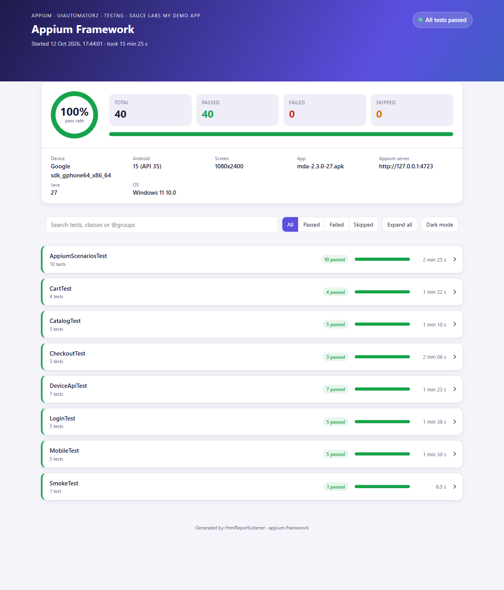
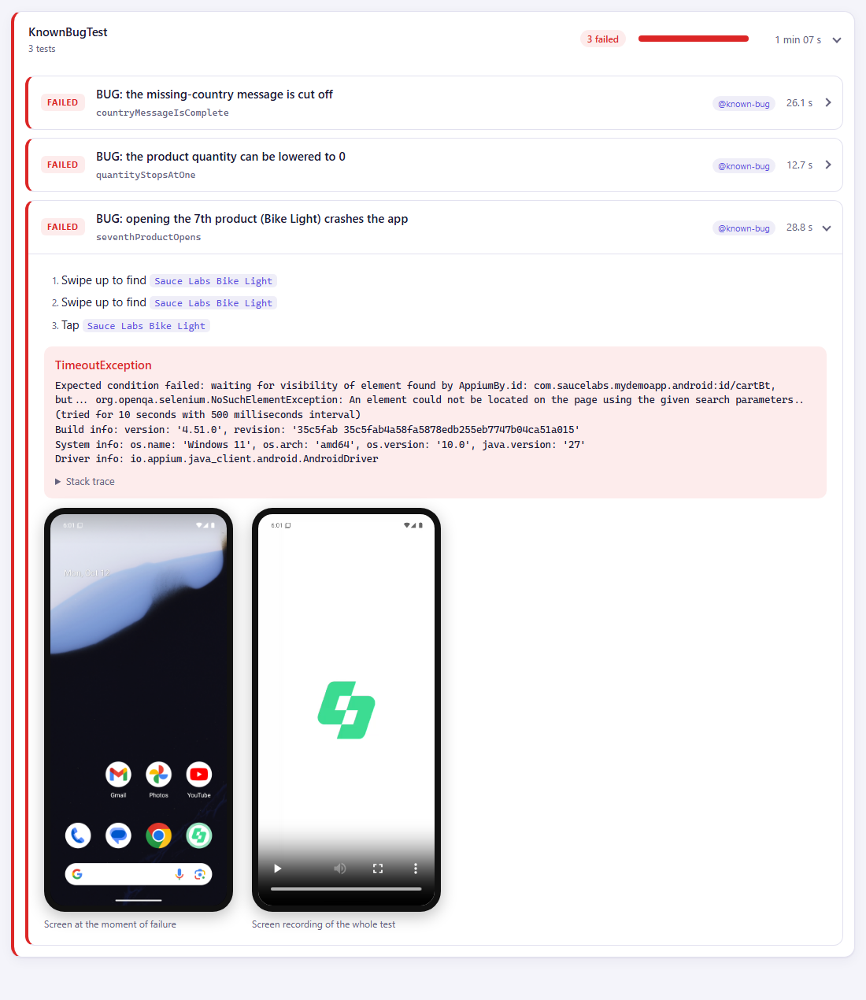

# Appium Framework

[](https://github.com/niranjankagri/appium-framework/actions/workflows/tests.yml)

Android mobile test automation with **Appium 3**, **Java 17** and **TestNG**, written against the
[Sauce Labs My Demo App](https://github.com/saucelabs/my-demo-app-android): catalog, cart, login and a
full checkout, plus phone behaviour (back button, background, cold start, rotation, keyboard).
Runs on a local emulator or a real phone, and on an Android emulator in GitHub Actions.



**Highlights**

- Page objects with built-in waits; tests read like user stories and hold no locators
- One Appium session per thread, app data cleared before every test (2 s instead of a new session)
- Custom HTML report: steps per test, and for failures a screenshot and a **screen recording**
- **Three real bugs found in the demo app** (a crash, a quantity bug, a cut-off message), kept as
  known-bug tests that turn green when the app is fixed
- Retries only when Android itself fails (an "app isn't responding" dialog), never on assertions
- Step-by-step [setup guide](docs/setup.md) for Windows without Android Studio, including Appium Inspector

## Contents

- [Tech stack](#tech-stack)
- [Project structure](#project-structure)
- [How it works](#how-it-works)
- [Tests](#tests)
- [Known app bugs](#known-app-bugs)
- [How to run](#how-to-run)
- [Reports](#reports)
- [Interview questions](#interview-questions)
- [CI](#ci)
- [Adding a test](#adding-a-test)
- [License](#license)

## Tech stack

| Part | Choice |
|---|---|
| Language | Java 17 (runs on newer JDKs, tested on 27) |
| Mobile automation | Appium 3.8 server, UiAutomator2 driver 8.7, Appium Java client 11 |
| Test runner | TestNG 7.12 (groups, suites, listeners, retry analyzer) |
| Build | Maven (Surefire 3.5.6) |
| Device | Android 15 emulator (`Pixel_API_35`, API 35) or a real phone over USB |
| App under test | Sauce Labs My Demo App 2.3.0 (Android, downloaded by a script, not committed) |
| CI | GitHub Actions with `reactivecircus/android-emulator-runner` |

## Project structure

```text
appium-framework
├── .github/workflows/tests.yml        CI: Android emulator, Appium, report artifact, run summary
├── docs/
│   ├── setup.md                       installation, device, Appium Inspector, troubleshooting
│   ├── framework-design.md            design decisions and why
│   └── interview-questions.md | .pdf  70 Appium interview questions answered with this framework
├── scripts/get-app.sh | get-app.ps1   downloads the pinned APK into apps/
├── src/main/java/com/automation/appium
│   ├── config/Config.java             config.properties, overridable with -Dkey=value
│   ├── driver/                        DriverManager (session per thread, app reset), CapabilitiesFactory
│   ├── screens/                       BaseScreen, Header, SideMenu, Device + one class per screen
│   ├── model/                         Address, Card (records)
│   └── report/                        Steps (step log), HtmlReportListener
├── src/main/resources/config.properties
├── src/test/java/com/automation/appium
│   ├── base/                          BaseTest (reset, recording, evidence), retry on device problems
│   ├── data/TestData.java             demo users, products, address, card
│   └── tests/                         Smoke, Login, Catalog, Cart, Checkout, Mobile, KnownBug
│       └── interview/                 Appium techniques asked in interviews, as runnable tests
├── testng.xml                         regular suite (known bugs excluded)
└── known-bugs.xml                     the known-bug tests only
```

## How it works

```text
Test  ──uses──▶  Screen objects  ──▶  BaseScreen (wait, tap, type, scroll, log step)
                                          │
                                   DriverManager (one session per thread)
                                          │
                     Appium server ──▶ UiAutomator2 ──▶ emulator / phone
```

- **Before each test** the app is stopped, its data cleared (`mobile: clearApp`) and started again, and the
  screen recording starts.
- **Screens wait for themselves**: `new CatalogScreen()` returns once the catalog is shown; every tap waits
  until the element can be tapped. No sleeps.
- **After each test** a failure keeps a screenshot and the recording; a pass throws the recording away.
- **Locators**: resource ids first, accessibility ids next, UiAutomator text only where there is no id,
  never XPath. The reasons, and the other decisions, are in [docs/framework-design.md](docs/framework-design.md).

## Tests

| Class | Tests | What |
|---|---|---|
| `SmokeTest` | 1 | the app opens on the catalog with an empty cart |
| `LoginTest` | 5 | valid login, locked-out user, missing user name, missing password, logout |
| `CatalogTest` | 5 | four sort orders; opening a product below the fold (scroll) |
| `CartTest` | 4 | badge and cart for one product, quantity 3, two products, removing an item |
| `CheckoutTest` | 3 | guest checkout end to end (total = cart + delivery), address validation, optional fields |
| `MobileTest` | 5 | back button, 3 s in the background, cold start, rotation lock, keyboard |
| `interview/AppiumScenariosTest` | 10 | locator strategies, W3C tap and drawing, attributes, element screenshot, page source, FluentWait, key events, permission dialog, WebView context |
| `interview/DeviceApiTest` | 7 | app states, device info, mocked GPS, clipboard, push/pull file, logcat, notification shade |
| `KnownBugTest` | 3 | open app defects, run separately |

Groups: `smoke`, `login`, `catalog`, `cart`, `checkout`, `mobile`, `interview`, `known-bug`.

### Test case IDs

Every app test starts with its case ID (`tc116_guestCompletesCheckout`, description `[TC-116] ...`). The 32 cases (TC-101 to TC-132, including the three known bugs TC-124 to TC-126) are written out for a manual run on a phone or emulator in [docs/manual-test-cases.md](docs/manual-test-cases.md). Interview tests that only demonstrate an Appium technique have no ID.

## Known app bugs

Found while writing the tests, on My Demo App 2.3.0 (Android 15 emulator):

| Bug | Evidence |
|---|---|
| Tapping the 7th or a later catalog product (Bike Light, T-shirts, jackets...) **crashes the app** | logcat: `ArrayIndexOutOfBoundsException: length=6; index=6` at `ProductCatalogFragment.java:156` |
| The minus button lowers the product quantity to **0** | quantity shows 0; "Add to cart" still enabled |
| The missing-country message reads **"Please provide your"** | the other four messages are complete sentences |

Each is a test in `KnownBugTest` that asserts the correct behaviour, so it fails today and passes once the
app is fixed. They are excluded from the regular suite and run with
`mvn test -DsuiteXmlFile=known-bugs.xml`.

## How to run

Full setup from scratch: **[docs/setup.md](docs/setup.md)**. With the Android SDK, the `Pixel_API_35`
emulator and Appium installed:

```powershell
powershell -ExecutionPolicy Bypass -File scripts\get-app.ps1   # or: bash scripts/get-app.sh
emulator -avd Pixel_API_35 -no-snapshot-save                   # terminal 1
appium --use-plugins=inspector --allow-cors                    # terminal 2
mvn test                                                       # terminal 3: 40 tests, ~16 min
```

| Run | Command |
|---|---|
| One group | `mvn test -Dgroups=smoke` |
| One class / method | `mvn test -Dtest=CheckoutTest` · `mvn test -Dtest=CartTest#addOneProduct` |
| Known app bugs | `mvn test -DsuiteXmlFile=known-bugs.xml` |
| Another device | `mvn test -Dudid=<adb serial> -DplatformVersion=14` |
| Without recording | `mvn test -DrecordVideo=false` |

In IntelliJ: right-click `testng.xml` > *Run*, or the arrow next to a test.

### Configuration

`src/main/resources/config.properties`; every key can be overridden with `-Dkey=value`.

| Key | Default | Meaning |
|---|---|---|
| `appiumUrl` | `http://127.0.0.1:4723` | Appium server |
| `deviceName` / `platformVersion` / `udid` | `Pixel_API_35` / `15` / empty | target device |
| `app` | `apps/mda-2.3.0-27.apk` | APK installed when missing |
| `explicitWait` | `10` | seconds to wait for an element |
| `recordVideo` | `true` | record each test, keep the video when it fails |

## Reports

After a run: **`target/surefire-reports/appium-test-report.html`** (one file; failure videos are in
`target/artifacts/` next to it).

- Summary with pass rate, device (model, Android version, screen), app and Appium server
- Tests grouped by class, failed classes first; search, status filter, light and dark mode
- Every test lists its steps: taps, typed values (passwords masked), swipes, device actions
- A failed test shows the error, the **phone screen at the moment of failure** and a **screen recording**



*The known 7th-product crash in the report: the steps up to the tap, the timeout that followed, the
Android home screen at the moment of failure (the app had crashed) and the recording of the whole test.*

## Interview questions

[`docs/interview-questions.md`](docs/interview-questions.md) (also as
[PDF](docs/interview-questions.pdf), 19 pages): 70 Appium + Java + TestNG interview questions with answers,
in nine topics (fundamentals, locators, waits, gestures, device control, framework design, flakiness and
reporting, hybrid/iOS/CI, scenarios) plus a quick-reference table. Every answer has an explanation, a short
example and an **In the framework** link to the file in this repository that does it (or why it is not used).

The `tests/interview` package turns common interview tasks into runnable tests (`mvn test -Dgroups=interview`).

## CI

[`.github/workflows/tests.yml`](.github/workflows/tests.yml) runs on every push and pull request:

1. Java 17, Node 24, Appium 3.8.0 and UiAutomator2 8.7.0 (the versions in the setup guide)
2. Downloads the APK, compiles, enables KVM, starts the Appium server
3. Boots an Android 15 emulator (API 35, Pixel 7 profile, animations off) and runs `mvn test`
4. Writes the totals to the run summary and keeps the HTML report, failure videos and `appium.log` as
   the artifact **appium-report**

A manual run (*Actions > Tests > Run workflow*) can choose `known-bugs.xml` instead.

The JUnit XML is kept as the separate artifact **junit-android**, which
[Automation Coverage & Quality Intelligence](https://github.com/niranjankagri/automation-coverage-quality-intelligence) collects.

CI also runs every Wednesday at 23:15 UTC without a code change, so a broken dependency or a change outside the repository shows up within a week. Dependabot proposes dependency and GitHub Actions updates once a month (minor and patch updates grouped, major versions as separate pull requests).

`main` is protected by a ruleset: every change goes through a pull request, and this CI job must pass before it is merged.

## Adding a test

1. Find the element in Appium Inspector ([setup.md, section 3](docs/setup.md#3-appium-server-and-appium-inspector)).
2. Add the locator and an action to the screen class (or a new screen extending `BaseScreen`); return the
   next screen from navigation methods.
3. Write the test in `tests/`, extend `BaseTest`, give it a group and a `description`:

```java
@Test(groups = "cart", description = "Adding a product shows 1 on the cart badge")
public void addOneProduct() {
    ProductScreen product = new CatalogScreen().openProduct(TestData.BACKPACK).addToCart();

    assertEquals(product.header().cartCount(), 1, "cart badge");
}
```

The app is reset before the test, so it starts on the catalog with an empty cart and nobody logged in.

## License

[MIT](LICENSE)
